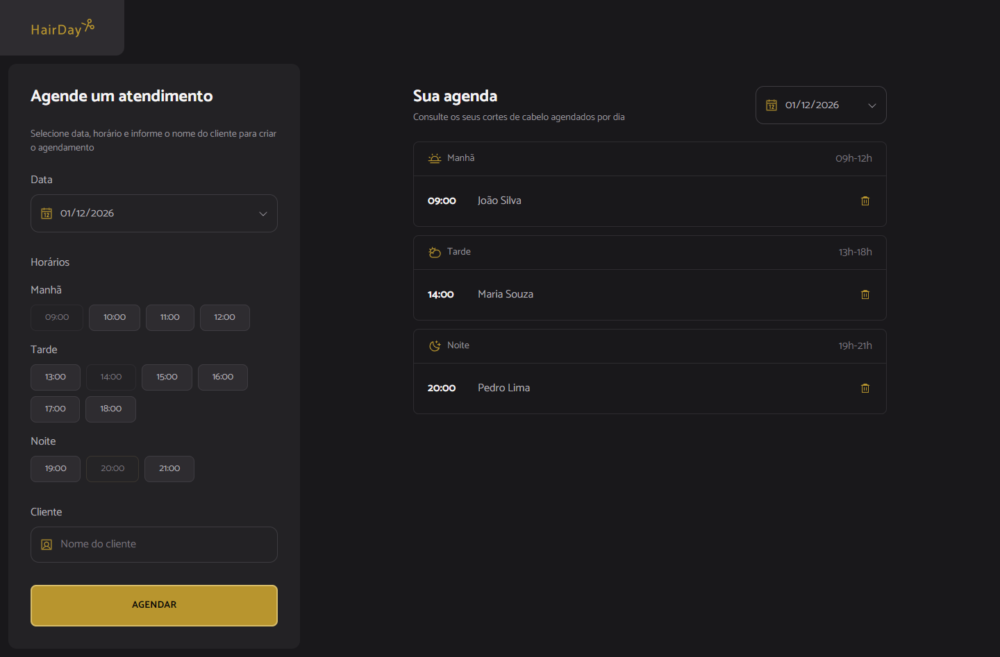
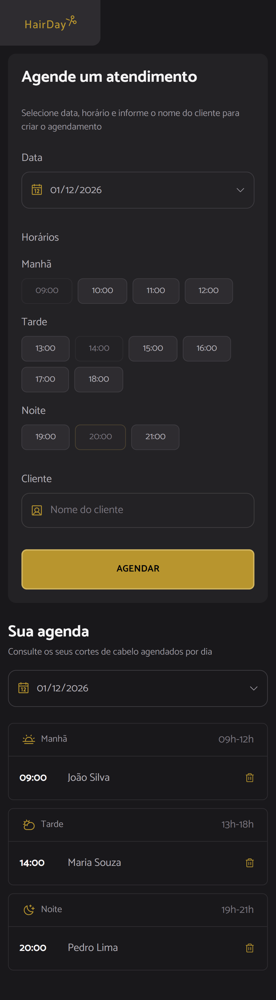
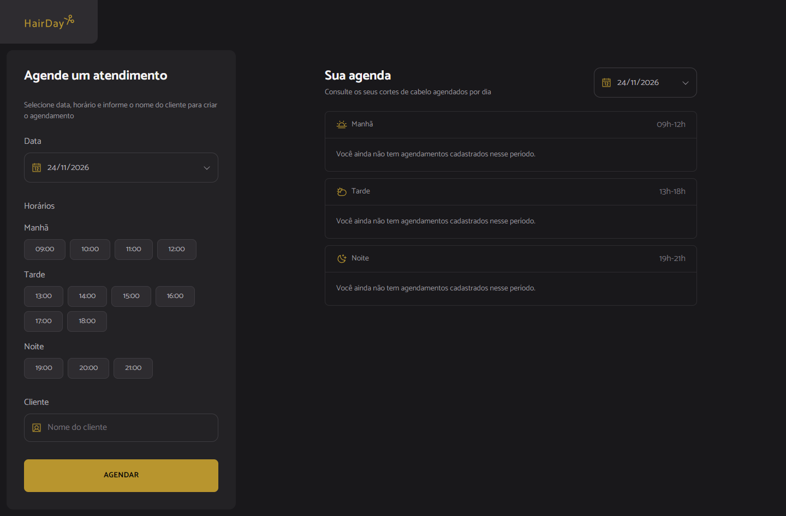
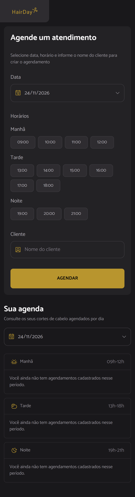

# HairDay — Agendamentos para salão/barbearia

Aplicação web de agendamentos para barbearia, construída com **React + Vite + TypeScript** e a identidade visual do projeto HairDay (tema escuro, dourado e tipografia Catamaran).

**Repositório:** https://github.com/wesleymiguelweb/agendamento_barbershop

## Preview

| Desktop | Mobile |
| --- | --- |
|  |  |

| Desktop vazio | Mobile vazio |
| --- | --- |
|  |  |

## Funcionalidades

- Cadastro de agendamento com **data, horário e nome do cliente**.
- Listagem por dia com seletor de data.
- Agrupamento por período: **Manhã (09h–12h)**, **Tarde (13h–18h)** e **Noite (19h–21h)**.
- Ordenação dos horários do menor para o maior.
- Seleção de horários em chips, com horários ocupados desabilitados por data.
- Exclusão imediata de agendamentos.
- Estado vazio por período com o texto:
  > Você ainda não tem agendamentos cadastrados nesse período.
- Validação de nome, data e horário com mensagem de orientação.
- Bloqueio de horários duplicados (mesma data + horário).
- Persistência em `localStorage`.
- Layout responsivo (desktop e mobile).

## Identidade visual

Design de referência: [Plataforma de agendamento (Community)](https://www.figma.com/design/MSPSJagLhcBTAsmZFQVKo1/Plataforma-de-agendamento--Community---Copy---Copy-?node-id=3-377) — nó `3-377`.

| Token | Valor |
| --- | --- |
| Fundo | `#19181B` |
| Superfície | `#232225` |
| Superfície elevada | `#2E2C30` |
| Texto principal | `#F5F4F5` |
| Texto secundário | `#B2AFB6` |
| Dourado principal | `#B8952E` |
| Dourado claro | `#DBC170` |
| Dourado escuro | `#846F2E` |
| Fonte | Catamaran (Google Fonts) |

- **Logo:** `src/assets/logo.svg` (importado no header).
- **Favicon:** `public/favicon.svg` (tesoura dourada).
- **Ícones:** [Phosphor Icons](https://phosphoricons.com/) — `UserSquare`, `Calendar`, `CaretDown`, `Trash`, `SunHorizon`, `CloudSun` e `MoonStars`.

## Stack

| Tecnologia | Uso |
| --- | --- |
| React 19 | Componentes e estado |
| Vite 8 | Dev server e build |
| TypeScript 7 | Tipagem estática |
| Phosphor Icons | Ícones da interface |
| CSS puro | Layout e design system |
| Playwright | Testes E2E e screenshots |
| oxlint | Lint |

## Como rodar

Pré-requisito: Node.js 20 ou superior.

```bash
npm install
npm run dev
```

Acesse http://localhost:5173.

### Build e preview

```bash
npm run build
npm run preview
```

O build de produção é gerado em `dist/`. O `preview` sobe em http://localhost:4173.

### Lint

```bash
npm run lint
```

### Testes E2E

```bash
npm run test:e2e
```

Os testes cobrem identidade visual, paleta, agenda vazia, criação de agendamentos, bloqueio de horário ocupado e exclusão, em desktop (1440×900) e mobile (Pixel 7).

## Evidências

- **Context7 MCP:** consultas reais ao servidor `context7` para Vite e React — [docs/evidence/context7.md](docs/evidence/context7.md).
- **Playwright MCP:** sessão real no servidor `@playwright/mcp` (navegação, snapshot e screenshot) — [docs/evidence/playwright-mcp.md](docs/evidence/playwright-mcp.md).
- **Testes Playwright:** execução de 4 testes aprovados — [docs/evidence/playwright-tests.md](docs/evidence/playwright-tests.md) e [saída completa](docs/evidence/playwright-tests.txt).
- **Screenshots:** [docs/screenshots](docs/screenshots).

## Estrutura

```
src/
  assets/logo.svg              # logo oficial HairDay
  components/
    Header.tsx                 # header com logo
    DatePicker.tsx             # seletor de data com ícones
    ScheduleForm.tsx           # formulário, validação e chips de horário
    Agenda.tsx                 # cabeçalho da agenda + seletor de data
    PeriodSection.tsx          # período com ícone, intervalo e lista
    AppointmentItem.tsx        # horário, cliente e exclusão
    EmptyState.tsx             # estado vazio obrigatório
  types/appointment.ts         # Appointment, Period, PeriodId
  utils/periods.ts             # períodos, horários e getPeriodId
  utils/storage.ts             # persistência em localStorage
  utils/date.ts                # todayISO e formatação de data
  App.tsx                      # estado global
  index.css                    # tokens de design
  App.css                      # estilos dos componentes
public/favicon.svg             # favicon da tesoura
tests/appointment.spec.ts      # testes Playwright
docs/evidence/                 # evidências de MCP e testes
docs/screenshots/              # capturas desktop e mobile
```

## Regras de negócio

- Agendamento: `{ id, client, date (YYYY-MM-DD), time (HH:mm) }`.
- Horários: 09:00–12:00, 13:00–18:00 e 19:00–21:00.
- Não é permitido cadastrar sem nome, data ou horário.
- Um horário já ocupado fica desabilitado para a data selecionada.
- A exclusão remove o agendamento imediatamente.
- Cada período sem agendamentos exibe o texto padrão de estado vazio.

## Autor

Wesley Miguel — [@wesleymiguelweb](https://github.com/wesleymiguelweb)
